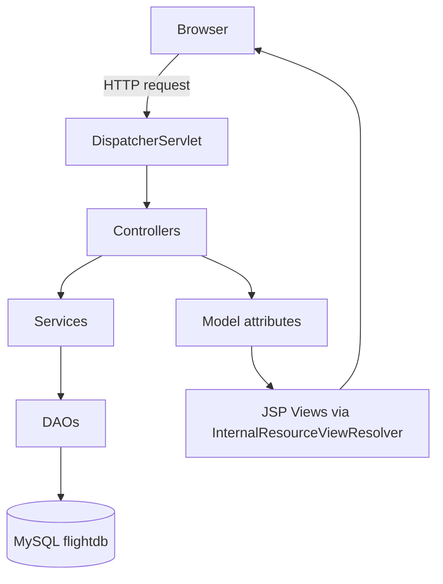

# Flight Reservation System — Complete Project Explanation

This document is written so you can explain the project confidently in an interview. It covers:
1. Request-by-request workflow (which file runs when and why)
2. Line-by-line explanation of every Java class
3. All technologies used and exactly where
4. A recommended study order so you master the project quickly

---

## 1. High-Level Architecture

This is a classic **Spring MVC (not Spring Boot) + JDBC + JSP** web application, packaged as a **WAR** and deployed on a servlet container (Tomcat). There is **no Hibernate/JPA** — all SQL is written by hand using `JdbcTemplate`.



**Layers (classic 3-tier / MVC):**
- **Controller layer** (`controller/`) — receives HTTP requests, talks to services, picks a view.
- **Service layer** (`service/`) — business logic, validation rules, transactions.
- **DAO layer** (`dao/`) — raw SQL via `JdbcTemplate`, talks to MySQL.
- **Model/DTO layer** (`model/`, `dto/`) — plain Java objects that carry data between layers and to/from JSP forms.
- **View layer** (`webapp/WEB-INF/views/*.jsp`) — JSP pages rendered by the `InternalResourceViewResolver`.
- **Config layer** (`config/`) — Java-based Spring configuration (no XML), replaces `web.xml` and `applicationContext.xml`.

---

## 2. Application Startup Flow (what runs first, and why)

There is **no `web.xml`**. Since Servlet 3.0, a class implementing `WebApplicationInitializer` is auto-discovered by the container at startup and treated like `web.xml`.

### Step-by-step boot sequence

1. **Tomcat starts** → scans the classpath for classes implementing `javax.servlet.ServletContainerInitializer`. Spring provides `SpringServletContainerInitializer`, which in turn discovers any `WebApplicationInitializer` implementation.
2. **`WebAppInitializer.onStartup()`** runs:
   - Creates the **root Spring context** (`AnnotationConfigWebApplicationContext`) registered with `AppConfig.class`. This context holds beans that are **not web-specific**: `DataSource`, `JdbcTemplate`, all `@Service` and `@Repository` beans.
   - Registers this root context with a `ContextLoaderListener` so it starts when the servlet context starts.
   - Creates a **child/MVC Spring context** registered with `WebConfig.class`. This context holds **web-specific** beans: `@Controller`s, the `ViewResolver`, validators.
   - Registers Spring's **`DispatcherServlet`** (the *front controller* of Spring MVC) under URL pattern `/` — meaning **every request** first hits `DispatcherServlet`.
3. **`AppConfig`** (root context) is processed:
   - `@PropertySource("classpath:application.properties")` loads DB credentials.
   - `@Value` fields (`driver`, `url`, `username`, `password`) get injected via the `PropertySourcesPlaceholderConfigurer` bean.
   - `dataSource()` bean builds an Apache Commons DBCP2 `BasicDataSource` (a connection pool) using those values.
   - `jdbcTemplate(DataSource)` bean wraps the pool in a `JdbcTemplate`, which every DAO uses to run SQL.
   - `@ComponentScan({"com.flightreservation.service", "com.flightreservation.dao"})` tells Spring to scan and instantiate all `@Service` and `@Repository` classes, injecting the `JdbcTemplate` into DAOs and DAOs into Services via constructor injection.
4. **`WebConfig`** (child context) is processed:
   - `@EnableWebMvc` turns on standard Spring MVC features (message converters, argument resolvers, `@Valid` support, etc.).
   - `@ComponentScan("com.flightreservation")` picks up `@Controller` classes and the `@Component` validator (this scan is broader but Spring is smart enough not to duplicate beans already created in the parent context — controllers specifically only exist here because parent didn't scan `controller` package).
   - `viewResolver()` bean: whenever a controller method returns a `String` like `"home"`, Spring resolves it to `/WEB-INF/views/home.jsp` by prepending prefix and appending suffix.
   - `addResourceHandlers()`: any request to `/resources/**` (like CSS) is served as a static file rather than routed to a controller.

**Why this design?** Splitting into root + child (web) context is the standard Spring MVC pattern: it lets you swap out the web layer (e.g., add REST alongside JSP) without touching business/data beans, and it keeps `@Controller`s out of the service-layer context so a `@Transactional` proxy or business bean never accidentally depends on a web-only bean.

---

## 3. Request-by-Request Walkthrough (which file executes, in order)

### A) Visiting the home page `GET /`
1. `DispatcherServlet` receives the request → matches `HomeController.home()` (`@GetMapping("/")`).
2. `HomeController` puts an empty `FlightSearchForm` in the `Model` (so the JSP form-binding tag has something to bind to) and returns view name `"home"`.
3. `ViewResolver` maps `"home"` → `/WEB-INF/views/home.jsp`.
4. `home.jsp` includes `fragments/header.jsp` (nav bar, reads `sessionScope.currentUser` to decide what links to show) and `fragments/footer.jsp`, and renders a Spring `<form:form>` bound to `searchForm`.

### B) Searching flights `POST /flights/search`
1. `DispatcherServlet` → `FlightController.search()`.
2. Spring binds submitted form fields into a `FlightSearchForm` object (`@ModelAttribute`).
3. `FlightSearchValidator.validate()` runs manually (not `@Valid`, called explicitly): checks source/destination not blank and not identical.
4. If `result.hasErrors()` → returns `"home"` again, JSP shows `<form:errors>` messages.
5. Else calls `FlightService.searchFlights(source, destination)` → `FlightDao.search()` runs a `SELECT ... WHERE LOWER(source)=LOWER(?) AND LOWER(destination)=LOWER(?)` via `JdbcTemplate`, mapped into `List<Flight>` by a `RowMapper` lambda.
6. Model gets `flights` and `search`; view `"searchResults"` (`searchResults.jsp`) lists them with a "Book" button per flight (linking to `/booking/start?flightId=...`).

### C) Signup `GET/POST /signup`
1. `GET` → `AuthController.signupForm()` puts empty `UserDto` in model, returns `"signup"`.
2. `POST` → `AuthController.doSignup()`:
   - `@Valid UserDto` triggers **Bean Validation** (`hibernate-validator`): checks `@NotBlank`, email regex, password complexity regex, role in {User, Admin}.
   - If `bindingResult.hasErrors()` → re-render `"signup"` with error messages next to fields.
   - Else `UserService.register(dto)`:
     - `UserDao.findByEmail()` checks for duplicate.
     - If free, builds a `User`, copies fields (**password stored in plain text — a known gap, see Security Notes**), `UserDao.save()` inserts a row.
   - On success redirects to `/login?registered=true` (Post/Redirect/Get pattern to avoid duplicate submits on refresh).

### D) Login `POST /login`
1. `AuthController.login()` calls `UserService.login(email, password)` → `UserDao.findByEmail()` then compares password with `.equals()`.
2. If match, the full `User` object is stored in `HttpSession` under key `"currentUser"` — **this is how the whole app tracks "who is logged in"**, no Spring Security involved.
3. Redirect: Admins → `/admin/dashboard`, normal Users → `/booking/my`.

### E) Booking a flight (customer flow)
1. From search results, user clicks a flight → `GET /booking/start?flightId=X` → `BookingController.start()`:
   - Guards: must be logged in (`session.getAttribute("currentUser") != null`), else redirect to `/login`.
   - Loads the `Flight` via `FlightService.getFlightById()`, computes `minDate`/`maxDate` (today .. +12 months) for the date picker, returns `"bookingForm"`.
2. User fills passenger names/genders/ages (dynamic rows in JS) and journey date, submits `POST /booking/confirm`:
   - Guard: `isCustomer(session)` — admins are blocked from booking.
   - Validates journey date range server-side again (defense in depth, don't trust the client).
   - Calls `BookingService.createBooking(...)`, which is `@Transactional`:
     - Reads the `Flight`, computes `available = capacity - bookingDao.countBookedSeats(flightId)`.
     - If passengers requested > available seats → throws `IllegalStateException` (caught in controller, error shown on the same form).
     - Else computes `total = pricePerSeat * seats`, builds a `Booking` (`status=CONFIRMED`), inserts it via `BookingDao.createBooking()` (uses `KeyHolder` to fetch the auto-generated `booking_id`).
     - Loops through each passenger, builds a `Ticket`, assigns a seat number via `generateSeatNo(index)` (rows of 6 seats: 12A..12F, 13A..), inserts via `BookingDao.addTicket()`.
   - On success redirects to `/booking/ticket/{bookingId}` (boarding pass / e-ticket page).
3. `GET /booking/ticket/{bookingId}` → `BookingController.ticket()`:
   - Loads the booking, **verifies `booking.getUserId() == currentUser.getUserId()`** (ownership check — prevents one user from viewing another's ticket just by guessing the ID, a.k.a. IDOR protection).
   - Loads the `Flight` and all `Ticket`s, renders `ticket.jsp`.
4. `GET /booking/my` → `BookingController.myBookings()` — lists all bookings for the session user via `BookingDao.findSummariesByUser()` (a SQL join of `booking` + `flight`).
5. Cancelling:
   - `POST /booking/cancel` (whole booking) → `BookingService.cancelBooking()` checks ownership then marks `booking` and all its `ticket` rows `CANCELLED`.
   - `POST /booking/ticket/cancel` (selected passengers only) → `BookingService.cancelTickets()` marks only chosen PNRs cancelled, recomputes remaining confirmed ticket count and new total price, and updates the parent booking's `seats`/`total_price`/`status` (auto-cancels the whole booking if 0 tickets remain).

### F) Admin flow
1. `GET /admin/dashboard` → `AdminController.dashboard()`:
   - Guard `isAdmin(session)` — reads `session.currentUser.role`, must equal `"Admin"` (case-insensitive), else redirect to `/login`.
   - Calls `FlightService.getUpcomingFlights()` / `getCompletedFlights()` → `FlightDao.findFlightStats(boolean upcoming)` runs a SQL aggregate query (`JOIN`, `GROUP BY`, `COALESCE`, `DATEDIFF`) returning `FlightStatsDto` per flight (bookings count, passengers count, revenue, days until departure).
2. `GET /admin/flight/add` → shows empty `FlightForm`.
3. `POST /admin/flight/add` → `AdminController.addSubmit()`:
   - `@Valid FlightForm` triggers Bean Validation annotations (regex for flight number format, HH:mm time pattern, capacity bounds, price digits).
   - Extra **cross-field** checks done manually because Bean Validation annotations can't easily compare two fields: source≠destination, arrival>departure — added as custom `result.rejectValue(...)` calls.
   - Calls `FlightService.addFlight(form)` → checks flight number uniqueness (`FlightDao.flightNumberExists`), converts form → `Flight` (`form.toFlight()`), inserts via `FlightDao.addFlight()`.
   - Uses **flash attributes** (`RedirectAttributes.addFlashAttribute`) to show a "flight added" banner once on the dashboard after redirect (Post/Redirect/Get).

### G) Errors
- Any `ResourceNotFoundException` (e.g., bad flight/booking id) or Spring's `EmptyResultDataAccessException` (a JDBC "no row found" when using `queryForObject`) is caught centrally by `GlobalExceptionHandler` (`@ControllerAdvice`) and rendered as a friendly `error.jsp` with a 404 status — instead of the controller/DAO code needing a try/catch everywhere.
- `IllegalStateException` (business rule violations, e.g., duplicate flight number outside the form flow) → 409 Conflict + `error.jsp`.
- Anything else → generic 500 page, exception logged to stderr, no stack trace leaked to the user.

---

## 4. Line-by-Line Explanation of Every Class

### 4.1 `config/AppConfig.java`
```java
@Configuration
@ComponentScan(basePackages = { "com.flightreservation.service", "com.flightreservation.dao" })
@PropertySource("classpath:application.properties")
public class AppConfig {
```
- `@Configuration`: marks this as a source of Spring bean definitions (Java-based config, replaces XML `<beans>`).
- `@ComponentScan`: tells Spring to find `@Service`/`@Repository` classes in those two packages and register them as beans (constructor-injected automatically).
- `@PropertySource`: loads `application.properties` into Spring's `Environment` so `@Value` can read `db.*` keys.

```java
@Value("${db.driver}") private String driver;
...
@Bean
public static PropertySourcesPlaceholderConfigurer placeholderConfigurer() {
    return new PropertySourcesPlaceholderConfigurer();
}
```
- The 4 `@Value` fields are placeholders that need `${...}` resolved — this only works because the `PropertySourcesPlaceholderConfigurer` bean exists (it's a `BeanFactoryPostProcessor` that scans for `${}` and replaces them; must be `static` because it runs very early, before normal bean instantiation).

```java
@Bean
public DataSource dataSource() {
    BasicDataSource ds = new BasicDataSource();
    ds.setDriverClassName(driver);
    ds.setUrl(url);
    ds.setUsername(username);
    ds.setPassword(password);
    return ds;
}
```
- Builds a **connection pool** (Apache Commons DBCP2) instead of opening a raw JDBC connection per request — reuses connections for performance.

```java
@Bean
public JdbcTemplate jdbcTemplate(DataSource dataSource) {
    return new JdbcTemplate(dataSource);
}
```
- `JdbcTemplate` is Spring's helper that removes JDBC boilerplate (opening/closing connections, statements, result sets, exception translation). Every DAO takes this as a constructor dependency.

### 4.2 `config/WebAppInitializer.java`
- Implements `WebApplicationInitializer` — Servlet-3.0 replacement for `web.xml`.
- `onStartup(ServletContext sc)`:
  - Builds root context → registers `AppConfig` → wraps in `ContextLoaderListener` → adds as a listener to the servlet context (this is what makes `getAttribute` work for `WebApplicationContextUtils` if ever needed, and is the *parent* of the MVC context).
  - Builds MVC context → registers `WebConfig`.
  - Creates `DispatcherServlet` with the MVC context, registers it under `"/"` (catch-all), `setLoadOnStartup(1)` means it initializes eagerly when the app starts (not lazily on first request) — so config errors surface immediately at deploy time.

### 4.3 `config/WebConfig.java`
- `@EnableWebMvc` + `implements WebMvcConfigurer`: standard annotation-driven Spring MVC setup (equivalent of `<mvc:annotation-driven/>` in XML).
- `@ComponentScan("com.flightreservation")`: broader scan that picks up `@Controller`s and `@Component` (the validator). This context is a **child** of the root context, so it can see root beans (services/daos) but root cannot see these.
- `viewResolver()`: `InternalResourceViewResolver` — logical view name → `/WEB-INF/views/<name>.jsp`. Placing JSPs under `WEB-INF` means they **cannot be requested directly by URL** (must go through a controller) — a basic security practice.
- `addResourceHandlers()`: maps `/resources/**` URL to the physical `/resources/` folder in the webapp — needed because `DispatcherServlet` maps `/` (everything), so without this, CSS/JS requests would 404 by being routed to controller matching instead of static file serving.

### 4.4 Controllers

**`HomeController`** — one `@GetMapping("/")` method. Seeds an empty `FlightSearchForm` (Spring's `<form:form>` tag requires a bound object to exist in the model even before the user has typed anything).

**`FlightController`** — one `@PostMapping("/flights/search")`. Uses a `Validator` object explicitly (`searchValidator.validate(form, result)`) rather than `@Valid`, because the cross-field "must differ" rule needs custom Java code (`Validator` interface), which is cleaner here than Bean Validation cross-field tricks.

**`AuthController`** — `signupForm`/`doSignup`/`loginForm`/`login`/`logout`.
- `doSignup` uses `@Valid @ModelAttribute UserDto` — Bean Validation annotations on the DTO fire automatically before the method body runs; `BindingResult` **must** immediately follow the validated argument or Spring throws instead of populating errors.
- `login` reads `@RequestParam` email/password directly (no DTO) since there's no client-side validation needed beyond "not found" — puts the found `User` into `HttpSession`.
- `logout` calls `session.invalidate()` — destroys the whole session, forcing re-login.

**`BookingController`** — the biggest controller, request-mapped under `/booking`.
- Private helper `isCustomer(session)` centralizes the "must be logged in AND not an admin" rule, used to keep admins from booking flights for themselves.
- `start()` (`GET /booking/start`): loads flight, computes date bounds, shows form. No booking yet, so no transaction needed.
- `confirm()` (`POST /booking/confirm`): takes **parallel lists** `passengerName[]`, `gender[]`, `age[]` from the JSP's repeatable passenger rows (Spring binds indexed request parameters to `List<String>` automatically when parameter names match `@RequestParam(name)` and the JSP inputs are named e.g. `passengerName`). Re-validates the date server-side, delegates to `BookingService`, and converts a thrown `IllegalStateException` (not enough seats) into a friendly re-rendered form instead of a generic error page.
- `confirmGet()`: safety net — if someone bookmarks or refreshes the confirm URL as GET, just bounce home instead of erroring.
- `ticket()`: **ownership check** `booking.getUserId() != user.getUserId()` before showing the ticket — critical for security (without it, changing the bookingId in the URL would let you see someone else's ticket).
- `myBookings()`, `cancel()`, `cancelTickets()`: session-guarded CRUD-style actions delegating straight to the service.

**`AdminController`** — request-mapped under `/admin`.
- `isAdmin(session)` helper, mirrors `isCustomer` but for the admin role.
- `dashboard()`: pulls two lists (`upcoming`/`completed`) of `FlightStatsDto` for the two dashboard tables.
- `addForm()` / `addSubmit()`: classic Spring MVC form flow — `@Valid` triggers the `FlightForm` annotations; manual `result.rejectValue(...)` adds cross-field checks the annotations can't express; catches `IllegalStateException` from the service (duplicate flight number) and re-shows the form with the error attached to the `flightNumber` field specifically (`result.rejectValue("flightNumber", ...)`); on success, uses **flash attributes** so the "flight added" confirmation only appears once, immediately after redirect, and disappears on refresh.

### 4.5 DAOs (`dao/`)

All three DAOs follow the same shape: a constructor-injected `JdbcTemplate`, a private `RowMapper<T>` lambda that converts one `ResultSet` row into a domain object, and public methods that run parameterized SQL (`?` placeholders — this is what prevents **SQL injection**, since `JdbcTemplate` always uses `PreparedStatement` under the hood).

**`UserDao`**: `save()` inserts, `findByEmail()` selects and returns `null` if no row (defensive `isEmpty()` check instead of letting `queryForObject` throw).

**`FlightDao`**:
- `search()`: case-insensitive match using `LOWER()` on both sides, trims input.
- `findById()`: wraps `queryForObject` in try/catch for `EmptyResultDataAccessException`, rethrows as the app's own `ResourceNotFoundException` — this is what lets `GlobalExceptionHandler` show a clean 404 rather than a stack trace.
- `flightNumberExists()`: `COUNT(*)` check used before insert to enforce uniqueness (there's no DB unique constraint being relied on here, uniqueness is app-enforced).
- `findFlightStats(boolean upcoming)`: builds a dynamic SQL string switching the comparison operator (`>=` vs `<`) based on the flag, joins `flight`→`booking`→`ticket`, aggregates counts/sums, and maps rows straight into `FlightStatsDto` with an inline lambda `RowMapper`.

**`BookingDao`**:
- `createBooking()`: uses `KeyHolder`/`GeneratedKeyHolder` with `Statement.RETURN_GENERATED_KEYS` to get the auto-increment `booking_id` back after insert — needed so tickets can immediately reference their parent booking.
- `addTicket()`: simple parameterized insert, one row per passenger.
- Three `RowMapper`s: `bookingMapper`, `ticketMapper`, `summaryMapper` (the latter maps a joined `booking+flight` query result directly into the flattened `BookingSummary` DTO used by the "My Bookings" page).
- `findOwnerId()`: returns just the `user_id` column — used purely for the ownership check in the service layer, avoids loading the whole booking just to check ownership.
- `cancelBooking()` / `cancelTicketsByPnr()`: `UPDATE` statements setting `status='CANCELLED'`.
- `countConfirmedTickets()` / `countBookedSeats()`: `COUNT(*)` queries used for seat-availability math.
- `syncBooking()`: rewrites the parent `booking` row's `seats`/`total_price`/`status` after a partial cancellation — this denormalized total needs to be kept in sync manually since there's no DB trigger.

### 4.6 Services (`service/`)

**`UserService`**: `register()` (checks duplicate email, copies DTO → entity, saves — comment flags password is stored in plain text, a known simplification/gap), `login()` (fetch by email, compare password with `.equals`).

**`FlightService`**: thin wrapper delegating to `FlightDao`, plus `ensureFlightNumberIsUnique()` shared by both `addFlight(Flight)` and `addFlight(FlightForm)` overloads — normalizes (trim) the flight number and throws `IllegalStateException` if blank or already taken. Applies a `DEFAULT_CAPACITY = 20` when the form's capacity is null.

**`BookingService`**: the most complex service, and the only one with `@Transactional` methods:
- `createBooking()`: computes availability, computes price, inserts a `Booking`, then loop-inserts `Ticket`s, generating seat labels with simple row/letter arithmetic (`row = 12 + index/6`, `letter = 'A' + index%6`). `@Transactional` ensures that if any ticket insert fails partway through, the whole booking (and any tickets already inserted) rolls back — you never end up with a "half booked" flight.
- `getBooking()`: wraps DAO lookup, throws `ResourceNotFoundException` if not found (translated by the DAO layer's null-return into a service-layer explicit exception).
- `cancelBooking()` / `cancelTickets()`: both check `ownerId == userId` before mutating anything — this is the actual authorization enforcement (defense against IDOR), also both `@Transactional` because they involve multiple related writes (booking + ticket tables) that must stay consistent.
- `getSeatsAvailable()`: capacity minus currently confirmed booked seats.

### 4.7 Models (`model/`) — plain getters/setters (POJOs), no framework annotations, used both as DB row representations and as data carried to JSPs.
- `User`: `userId`, `email`, `password`, `role`.
- `Flight`: route + timings + `capacity` (defaults to 20) + `pricePerSeat`.
- `Booking`: one reservation record; `getJourneyDateText()` exists because **JSTL/EL cannot call `DateTimeFormatter` directly**, so the model pre-formats the date as a display-ready string (`"EEE, dd MMM yyyy"`).
- `BookingSummary`: a *flattened, read-only* view combining a booking with its flight's route/time (used for the my-bookings list so the JSP doesn't need nested object navigation); also has `isCancellable()` (`true` only while `status == CONFIRMED`) which the JSP uses to conditionally show a Cancel button.
- `Ticket`: one passenger's seat under a booking (`pnrNo`, `seatNo`, `status`), same date-formatting helper pattern.
- `FlightSearchForm`: two fields, `source`/`destination`, purely a form backing object for the home page search.

### 4.8 DTOs (`dto/`) — objects tied to Bean Validation for form input, or read-only query results.
- `FlightForm`: admin's "add flight" form. Every field has Bean Validation annotations (`@NotBlank`, `@Pattern` regex for flight number/time format, `@Size`, `@Min/@Max`, `@DecimalMin/@DecimalMax/@Digits` for price). `toFlight()` converts the validated form into a persistence-ready `Flight`, uppercasing/trimming the flight number.
- `UserDto`: signup/login form — email regex, password complexity regex (`(?=.*[0-9])(?=.*[a-z])(?=.*[A-Z])(?=.*[@#$%^&+=!])(?=\S+$){8,20}`, i.e., must contain a digit, lowercase, uppercase, special char, no whitespace, 8-20 length), role restricted to `User`/`Admin` via regex.
- `FlightStatsDto`: **immutable** (all fields `final`, set only via constructor, no setters) — a pure read-only projection for the admin dashboard's aggregate SQL query, never persisted.

### 4.9 Exceptions (`exception/`)
- `ResourceNotFoundException extends RuntimeException`: unchecked, thrown by DAOs/services when an id doesn't exist.
- `GlobalExceptionHandler` (`@ControllerAdvice`): intercepts exceptions thrown by **any** controller in the app (cross-cutting, avoids try/catch duplication):
  - `ResourceNotFoundException` / `EmptyResultDataAccessException` → 404 + `error.jsp`.
  - `IllegalStateException` → 409 + `error.jsp` (business rule conflicts).
  - Anything else → 500, logs to `System.err`, shows a generic safe message (never leaks the real exception/stack trace to the browser — an OWASP-relevant practice, avoids information disclosure).

### 4.10 Validator (`validator/FlightSearchValidator.java`)
- Implements Spring's `Validator` interface (`supports()` + `validate()`), used explicitly (not via `@Valid`) inside `FlightController` because it needs to compare two fields against each other, which plain annotation-based validation on individual fields can't express as elegantly.
- `ValidationUtils.rejectIfEmptyOrWhitespace` is a Spring helper that shortcuts the common "not blank" check with an error code + message.

### 4.11 Views (JSP) — brief tour
- `fragments/header.jsp` / `footer.jsp`: shared layout, included via `<%@ include %>` in every page (not fetched separately — this is **static/compile-time include**, unlike `<jsp:include>` which is dynamic/runtime). Header reads `sessionScope.currentUser` to decide nav links (guest/user/admin) — this is why login state lives in `HttpSession`, so JSP can read it directly via EL without extra plumbing.
- `home.jsp`: search form using Spring's `<form:form>`/`<form:input>`/`<form:errors>` tags, which auto-bind to the `searchForm` model attribute and print validation errors next to the right field.
- `searchResults.jsp`, `bookingForm.jsp`, `myBookings.jsp`, `ticket.jsp`, `addFlight.jsp`, `adminDashboard.jsp`, `login.jsp`, `signup.jsp`, `error.jsp`, `fragments/statCard.jsp`: each corresponds 1:1 to a view name returned by a controller method (see section 3 above for exactly which controller method renders each one).

### 4.12 Tests (`src/test/java`)
- `UserServiceLoginTest`, `UserServiceSignupTest`: JUnit 5 + Mockito unit tests for `UserService`.
  - `@ExtendWith(MockitoExtension.class)` enables `@Mock`/`@InjectMocks` processing.
  - `@Mock UserDao userDao`: a fake DAO, so the test never touches a real database.
  - `@InjectMocks UserService userService`: Mockito creates a real `UserService` and injects the mocked DAO into its constructor.
  - `when(...).thenReturn(...)`: stubs DAO behavior per test case (found user / not found / duplicate).
  - `verify(userDao).save(...)` / `verify(userDao, never()).save(...)`: asserts whether a save call happened — this is how you unit-test **business logic in isolation** without a real DB, keeping tests fast and deterministic.

---

## 5. Technologies Used, and Where

| Technology | Version | Where used | Why |
|---|---|---|---|
| **Java** | 17 | whole project | language + records-ready runtime |
| **Maven** | (pom.xml) | build tool | dependency management, `war` packaging |
| **Spring Context / Core** | 5.3.39 | `config/AppConfig`, `@Service`/`@Repository`/`@Component` beans | Dependency Injection (IoC) container |
| **Spring MVC (spring-webmvc)** | 5.3.39 | `config/WebConfig`, all `controller/*` | front-controller pattern, `@Controller`, data binding, view resolution |
| **Spring JDBC (spring-jdbc)** | 5.3.39 | all `dao/*` | `JdbcTemplate`, `RowMapper`, `KeyHolder` — no ORM |
| **Spring Transaction Management** | (part of spring-context) | `BookingService` `@Transactional` methods | atomic multi-statement DB writes with rollback |
| **MySQL + mysql-connector-java** | 8.0.33 | `flightdb` schema, DAOs | relational data store |
| **Apache Commons DBCP2** | 2.9.0 | `AppConfig.dataSource()` | JDBC connection pooling |
| **Servlet API (javax.servlet)** | 4.0.1 (`provided`) | `WebAppInitializer`, `HttpSession` usage in controllers | servlet container contract, compiled against but supplied by Tomcat at runtime |
| **JSP + JSP API** | 2.3.3 (`provided`) | `webapp/WEB-INF/views/*.jsp` | server-rendered HTML views |
| **JSTL** | 1.2 | `<c:if>`, `<c:choose>`, `<c:set>`, `<fn:toUpperCase>` in JSPs | core/functions tag libraries used in fragments and views |
| **Spring `<form:*>` tag library** | via spring-webmvc | `home.jsp` and other form JSPs | 2-way data binding + auto error display for `BindingResult` |
| **Bean Validation (JSR-380) + Hibernate Validator** | validation-api 2.0.1, hibernate-validator 6.2.5 | `dto/UserDto`, `dto/FlightForm` (`@NotBlank`, `@Pattern`, `@Size`, `@Min`, `@Max`, `@DecimalMin/Max`, `@Digits`) | declarative input validation, triggered via `@Valid` |
| **Spring `Validator` interface** | spring-context | `validator/FlightSearchValidator` | custom cross-field validation logic not expressible with annotations |
| **SLF4J + Logback** | 2.0.13 / 1.5.6 | logging dependency (available project-wide) | structured logging (though current code mostly uses `System.err` in the exception handler) |
| **JUnit 5 (Jupiter)** | 5.10.2 | `src/test/java/.../service/*Test.java` | unit testing framework |
| **Mockito (+ mockito-junit-jupiter)** | 5.11.0 | same test classes | mocking DAOs to isolate the service layer under test |
| **Maven WAR Plugin** | 3.4.0 | `pom.xml` build | packages the app as a deployable `.war` |
| **Maven Surefire Plugin** | 3.2.5 | `pom.xml` build | runs JUnit 5 tests during `mvn test`, with JVM args for Mockito's inline mock agent on JDK 17 |
| **HttpSession (server-side session)** | javax.servlet | login/logout, all "am I logged in" guards | app's own hand-rolled authentication/authorization (no Spring Security) |
| **`@ControllerAdvice` / `@ExceptionHandler`** | spring-webmvc | `exception/GlobalExceptionHandler` | centralized error handling across all controllers |

**Design patterns you can name-drop in an interview:**
- **Front Controller** — `DispatcherServlet`.
- **MVC** — Controller / Service+Model / View (JSP).
- **DAO (Data Access Object)** — `dao/*` isolating SQL from business logic.
- **DTO (Data Transfer Object)** — `dto/*` for form binding, decoupled from `model/*` persistence objects.
- **Dependency Injection / IoC** — constructor injection everywhere, managed by Spring's `ApplicationContext`.
- **Post/Redirect/Get** — every form POST that succeeds ends in a redirect (`signup`, `addSubmit`, `confirm`) to prevent duplicate submissions on refresh.
- **Flash attributes** — one-time data passed across a redirect (`AdminController.addSubmit`).
- **Row Mapper / ORM-lite mapping** — manual `RowMapper<T>` lambdas instead of Hibernate.
- **Repository pattern (loosely)** — `@Repository` DAOs.

---

## 6. Known Simplifications / Things You Should Be Ready to Discuss

Be upfront about these if asked "what would you improve":
1. **Passwords stored in plain text** (`UserService.register`, comment even flags it) — should use `BCryptPasswordEncoder`.
2. **No Spring Security** — auth/authorization is hand-rolled via `HttpSession` attribute checks in each controller (`isAdmin`/`isCustomer` helpers) — works, but duplicated and easy to forget on a new endpoint. Real apps would centralize this with a security filter/interceptor.
3. **DB credentials committed in `application.properties`** (including a real-looking password) — should be externalized (env vars, secrets manager) and never committed.
4. **No pagination** on flight lists / dashboard stats — fine for a demo dataset, would need it at scale.
5. **Flight number & DB constraints**: uniqueness enforced only in app code (`flightNumberExists`), not with a DB `UNIQUE` constraint — a race condition (two admins submitting simultaneously) could still create duplicates; a real system would add a DB constraint as the source of truth and treat the app check as a fast-fail UX nicety.

---

## 7. Recommended Study Order (to master the project fast)

Follow this order — each step builds on the last:

1. **Fundamentals refresh** (skip if solid): Java OOP, HTTP request/response basics, what a servlet container does.
2. **`pom.xml`** — understand every dependency's purpose (use the table in section 5). Know why it's `war` packaging, not a Spring Boot `jar`.
3. **`config/WebAppInitializer.java` → `AppConfig.java` → `WebConfig.java`** — the boot sequence. This is the #1 thing interviewers probe on non-Boot Spring MVC projects: "how does this even start without `web.xml`?"
4. **`application.properties`** — see how `@Value`/`@PropertySource` connect to `AppConfig`.
5. **One full vertical slice end-to-end**: pick the simplest — Home → Search:
   - `HomeController` → `home.jsp` → `FlightController` → `FlightSearchValidator` → `FlightService` → `FlightDao` → `searchResults.jsp`.
   - Understand `RowMapper`, `JdbcTemplate.query`, parameterized SQL.
6. **Auth slice**: `AuthController` → `UserService` → `UserDao` → `User` model → `HttpSession` usage in `header.jsp`. Understand Bean Validation on `UserDto`.
7. **Booking slice (the most complex, do this once the above feels natural)**:
   - `BookingController.start/confirm` → `BookingService.createBooking` (seat math, `@Transactional`, ticket generation) → `BookingDao` (`KeyHolder`, joins) → `ticket.jsp`/`myBookings.jsp`.
   - Then cancellation flows (`cancelBooking`, `cancelTickets`) and the ownership checks.
8. **Admin slice**: `AdminController` → `FlightForm` validation rules → `FlightService.addFlight` → `FlightDao.findFlightStats` (the aggregate SQL — be ready to explain the `JOIN`/`GROUP BY`/`COALESCE`/`DATEDIFF`).
9. **Cross-cutting concerns**: `GlobalExceptionHandler`, `ResourceNotFoundException`, and how validation errors flow from DTO annotations → `BindingResult` → JSP `<form:errors>`.
10. **Tests**: `UserServiceLoginTest`/`UserServiceSignupTest` — understand Mockito `@Mock`/`@InjectMocks`/`when`/`verify`, and be ready to explain *why* services are unit-tested with mocked DAOs instead of hitting a real DB.
11. **View layer polish**: skim `fragments/header.jsp` (role-based nav) and one or two JSPs (`bookingForm.jsp`, `adminDashboard.jsp`) to see how `<form:*>` and JSTL tags consume the model attributes you've now traced through every layer.
12. **Finish with section 6 above** (known gaps) — interviewers love asking "what would you improve," and having a ready, honest answer shows maturity.

**Interview tip:** be ready to draw the request flow diagram from memory (Browser → DispatcherServlet → Controller → Service → DAO → DB → back through Model → View → Browser) and to explain *why* there are two Spring contexts (root vs. web) — that single detail proves you understand non-Boot Spring MVC deeply.
